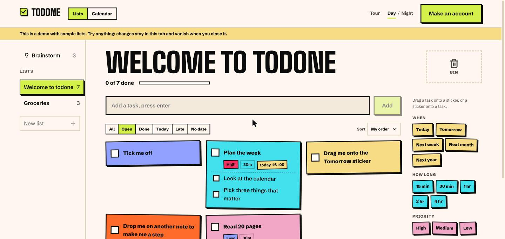

# todone

**[todone.today](https://todone.today)** · An open-source todo app: sticky notes you drag onto a day, a calendar to plan the week on, and teams to share it with. It works offline.

**[Try the demo](https://todone.today/demo)** (no account) · [Guide](https://todone.today/docs) · [Changelog](https://todone.today/changelog) · [Status](https://todone.today/status)

- Lists of sticky notes; drop one note on another to make it a step
- Stickers for when, how long, priority and repeats
- Day, week, month and year calendar; drag tasks onto a time and stretch them to fit
- Brainstorm for loose ideas, and Import with AI to turn a brain dump into lists
- Teams with members, roles and invitations
- Google Calendar, Notion, Obsidian (Markdown), Discord, a calendar feed for Apple and Outlook, and push reminders
- Export everything as JSON or CSV; delete your account any time

## Repos

| Repo | What it is |
|---|---|
| [server](https://github.com/todone-today/server) | The API: accounts and teams, lists, integrations, reminders, migrations, self-hosting |
| [clients](https://github.com/todone-today/clients) | The apps people use; today the Next.js web app |
| [sdk](https://github.com/todone-today/sdk) | Shared logic: tasks and their Markdown format, calendar, export, sync |
| [contributing-docs](https://github.com/todone-today/contributing-docs) | How to run, change and deploy it |

Free and open source under GPL-3.0. Self-host it with Docker Compose, or use [todone.today](https://todone.today).
